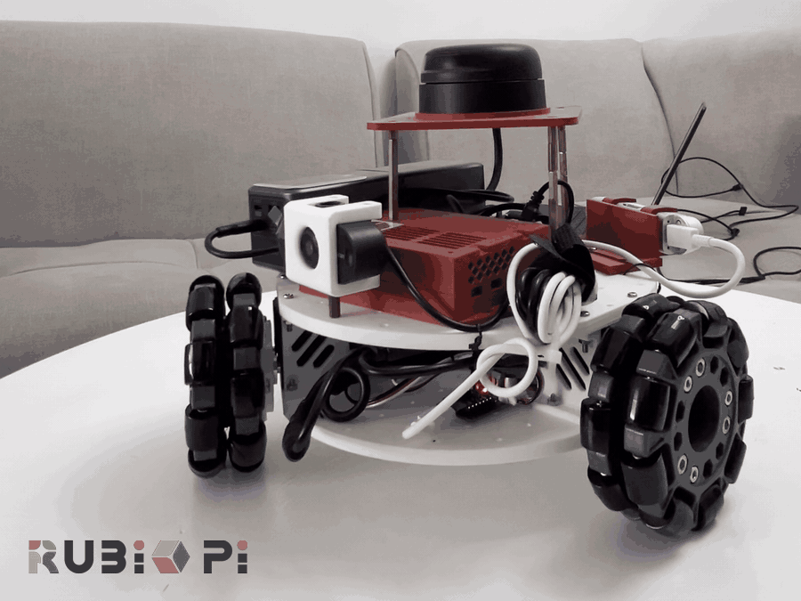

# LeKiwi Mobile Robot on Qualcomm Rubik Pi 3

An AI-ready omnidirectional mobile robot built on the open-source
[LeKiwi](https://github.com/SIGRobotics-UIUC/LeKiwi) base and the Thundercomm
Rubik Pi 3 (Qualcomm QCS6490, 12 TOPS). It streams LiDAR, depth, and RGB to a
Rerun viewer in real time and drives from a touch joystick in any browser.



Everything runs on the single board at 4 to 8 watts with no cloud dependency.
This is the sensor and control foundation for on-device navigation and VLM
work in later phases.

## Hardware

- LeKiwi omni base, three Feetech STS3215 servos at 120 degrees (kiwi drive)
- Thundercomm Rubik Pi 3 (Qualcomm QCS6490)
- Slamtec RPLiDAR A2 (360 degree 2D scan over USB serial)
- Intel RealSense D415 (aligned RGB and depth over USB 3.0)
- 12V lithium battery for the wheels, USB-C PD power bank for the Rubik Pi

### Wiring

Power and data wiring is in [`docs/wiring_schematic.png`](docs/wiring_schematic.png)
(editable source: [`docs/wiring_schematic.svg`](docs/wiring_schematic.svg)).

| Connection | Port on Rubik Pi 3 |
| --- | --- |
| Motor board (STS3215 servos) | USB-A, /dev/ttyACM0 |
| RPLiDAR A2 | USB-A, /dev/ttyUSB0 |
| Intel RealSense D415 | USB 3.0 Type-A |
| Rubik Pi power | USB-C PD |

The three wheel servos are powered from the 12V battery through the servo
driver, not from the Pi's USB rails.

## Software stack

| Component | Role |
| --- | --- |
| LeRobot (FeetechMotorsBus) | Motor control and kiwi-drive inverse kinematics |
| Rerun 0.37+ | Real-time LiDAR, depth, and RGB visualization over gRPC |
| FastAPI + WebSocket | Browser teleop UI served from the robot |
| pyrealsense2 | D415 color and depth streams |
| rplidar-roboticia | RPLiDAR A2 driver |
| OpenCV, NumPy | JPEG encoding and array handling |

The two scripts run as independent processes, so a viewer crash or a network
hiccup on the visualization side can never stall the motor control loop.

## Setup

Clone the repo on the Rubik Pi 3 and install the dependencies:

```bash
pip install -r requirements.txt
```

`lerobot` must be available in the environment (install it separately if it is
not already set up).

## Run

### Sensor streaming and keyboard teleop

```bash
python3 lekiwi_teleop_rerun.py
```

Viewer options are set at the top of the script with `VIEWER_MODE`:

- `web`: open `http://<ROBOT_IP>:9090` in a browser, nothing to install
- `connect`: run the native `rerun` viewer on a laptop and set `LAPTOP_IP`
- `spawn`: local viewer on the robot (needs a display)

Keyboard controls:

```
W / S     forward / back      (incremental, each press adds speed)
A / D     strafe left / right
Q / E     rotate CCW / CW
Space     stop
X / Esc   quit
```

### Web joystick teleop (laptop or iPad)

Run alongside the streaming script:

```bash
python3 lekiwi_web_teleop.py
```

Then open `http://<ROBOT_IP>:8000` on any device on the same network. Two
virtual joysticks (translation and rotation) plus a STOP button, no app and no
pairing.

## Safety

Teleop input is incremental and velocity based. The motors stop in two cases:
releasing the joystick sends zero velocity, and if the WebSocket disconnects
(tab closed, wifi dropped, browser crashed) the server writes zero to all three
wheels. There is no state where the robot keeps driving after you lose control.

## License

MIT, see [LICENSE](LICENSE).
